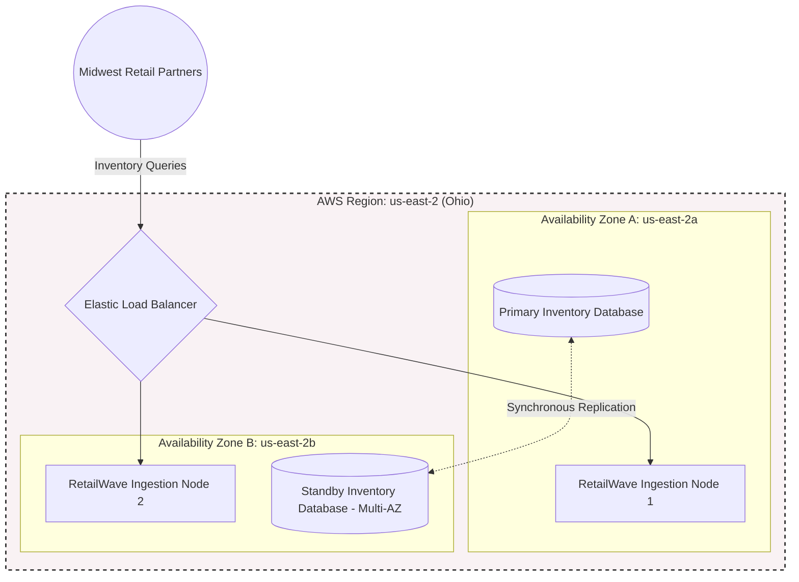
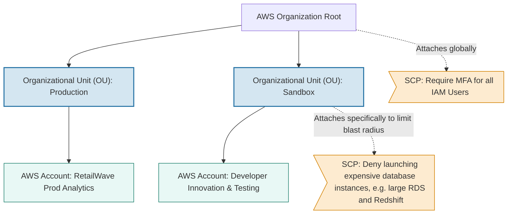

# Infrastructure and Governance Diagrams

**Client:** RetailWave Analytics
**Project:** Cloud Migration & Governance Foundation - Architectural Brief
**Author:** ApexCloud Solutions Consultancy Team

---

## Part 1: High Availability Strategy (AWS Global Infrastructure)

**Context:** The 48-hour outage was caused by a localized power grid failure in Chicago. The design below removes that single point of failure by spreading the workload across two Availability Zone (AZ) nodes inside one AWS Region.

### How to read this diagram

- **AWS Region:** a geographic area (here, us-east-2 in Ohio, in the Midwest and outside the Chicago power grid) made up of multiple isolated locations.
- **Availability Zone (AZ):** one or more physically separate data centers within the AWS Region, each with independent power, cooling, and networking. Zone A and Zone B are connected by low-latency links.
- **Elastic Load Balancer:** sends partner requests only to healthy ingestion nodes.
- **Synchronous Replication:** every write to the primary database is also written to the standby in the other AZ before it is confirmed.

### Failure scenario: Zone A loses power (a repeat of the Chicago outage)

| Step | What happens | Effect on retail partners |
|---|---|---|
| 1 | Availability Zone A goes offline. | None yet. |
| 2 | The Elastic Load Balancer detects Ingestion Node 1 is unhealthy and stops routing to it. | Requests continue through Node 2 in Availability Zone B. |
| 3 | The Multi-AZ database automatically promotes the standby to primary. | Typically a short failover (on the order of a minute or two), not 48 hours. |
| 4 | When Zone A recovers, it rejoins the architecture. | None. |

**Result:** a single localized datacenter failure no longer takes the inventory reporting systems down. Note that this design protects against the loss of one AZ. Protection against the loss of an entire AWS Region would require an additional multi-Region design, which is outside the scope of this brief.

---

## Part 2: Multi-Account Strategy (AWS Organizations)

**Context:** To address executive concerns about security and uncontrolled cloud spending (bill shock), RetailWave will separate Production from experimental work using AWS Organizations, OUs, and SCPs.

### How to read this diagram

| Element | Meaning |
|---|---|
| **AWS Organizations** | The service that groups all RetailWave AWS accounts under one root for central governance and billing. |
| **OUs** | Organizational Units: folders of accounts. **Production** holds live customer data; **Sandbox** holds experimental developer work. |
| **SCPs** | Service Control Policies: guardrails that set the maximum permissions available in an account. They do not grant access by themselves; they only limit what IAM can allow. |
| **SCP: Require MFA** | Attached at the root, so it applies to every OU and account below it. |
| **SCP: Deny expensive database instances** | Attached only to the **Sandbox** OU. Even a Sandbox administrator cannot launch these resources, so experiments cannot create bill shock. Production is unaffected. |

### Why attach the cost SCP to the Sandbox OU?

- Attaching it to the **OU** (not the account) means every future Sandbox account inherits the guardrail automatically.
- Attaching it to Sandbox only keeps Production free to run the large database instances it needs.
- Separate accounts mean a Sandbox mistake cannot touch Production inventory data.

> **Note:** SCPs apply to member accounts, not to the Organizations management account. The management account should therefore host no workloads and be tightly restricted.
